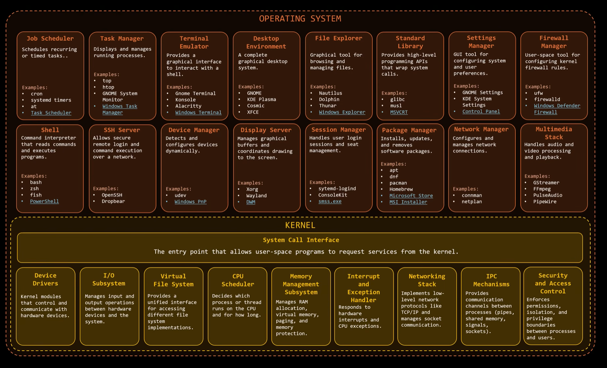

# DCC (Data Centric Computing), documentación para aprender

# Seguridad

[Actor Model](https://en.wikipedia.org/wiki/Actor_model)

[Crockford on JavaScript - Part 5: The End of All Things](https://www.youtube.com/watch?v=47Ceot8yqeI)

[The Lazy Programmer's Guide to Secure Computing](https://www.youtube.com/watch?v=eL5o4PFuxTY)

[Arm Morello Program](https://www.arm.com/architecture/cpu/morello)

[CHERI - The Digital Security by Design (DSbD) Initiative](https://www.cl.cam.ac.uk/research/security/ctsrd/cheri/dsbd.html)

# Temas que ha de atender un Sistema Operativo

[The Question Nobody Ever Explains: Where Does the Kernel End? - Core Dumped](https://www.youtube.com/live/ZmPIxfCggFw)

Las dos principales tareas que ha de desempeñar un sistema operativo son:

- Facilitar la programación de software, proporcionando un entorno estandarizado y estable. Con una serie de servicios comunes, independientes del hardware.

- Regular/coordinar el trabajo de los distintos programas que puedan estar corriendo en el sistema en un momento dado.

## Servicios básicos - el núcleo (kernel)

Para ello el núcleo (kernel) del sistema operativo se ha de ocupar de aspectos tales como:

- Drivers para los dispositivos hardware.

- Gestión de interrupciones y de excepciones.

- Gestión de la ejecución (Virtual CPU|GPU)
  - Scheduler (tiempo)
  - Dispatcher (recursos)

- Gestión de la memoria (Virtual Memory)

- Control de autentificación y autorización (QUIEN puede hacer QUÉ)

- Gestión del almacenamiento (Virtual File System)
  - Versioning File System (con control de cambios)
  - Journaling File System (con registro-log- de cambios)

- Comunicación entre procesos y entre aplicaciones dentro de la propia máquina
  - IPC (Inter-Process Communication)
  - Pipes
  - Shared Memory
  - Sockets
  - ...

- Comunicación con otras máquinas (networking)

- Gestión de los comandos e información desde el usuario (Virtual InputInterfaces)
  - Teclado
  - Ratón
  - Microfono
  - ...

- Gestión de la realimentación e información hacia el usuario (Virtual OutputInterfaces)
  - Pantallas
  - Sonidos
  - ...

- API para acceder a todos los servicios citados desde el software de usuario. (System Call Interface)

## Utilidades de usuario

Además de los servicios básicos del kernel. Los sistemas operativos suelen incluir toda una serie de utilidades de usuario. 

Las dos utilidades principales suelen ser un terminal de comandos y un escritorio gráfico. Desde cualesquiera de ellos, el usuario puede interactuar con el sistema.

Suele ser muy típico incluir también toda una serie de utilidades para configurar, monitorizar, gestionar, instalar,... los programas y la información que están en el sistema.

## El proceso de arranque

Desde que se enciende el hardware, hasta que el sistema operativo pueda hacerse cargo del mismo. Algo ha de cargar y ejecutar ese sistema operativo. Esta es la tarea del *firmware* y del proceso de *bootstrap*.

# Algunos enlaces a documentación sobre sistemas operativos

[Philipp Oppermanns's blog - Writing an OS in Rust](https://os.phil-opp.com/)

[The Linux Kernel documentation](https://www.kernel.org/doc/html/latest/)

## OS Dev Wiki

[Beginner Mistakes](https://wiki.osdev.org/Beginner_Mistakes)

[Getting Started](https://wiki.osdev.org/Getting_Started)

[Bare Bones Development](https://wiki.osdev.org/Bare_Bones)

[Executable Formats](https://wiki.osdev.org/Category:Executable_Formats)

[OS theory](https://wiki.osdev.org/Category:OS_theory)

[a GCC cross-compiler for your own operating system](https://wiki.osdev.org/GCC_Cross-Compiler)

[Rust](https://wiki.osdev.org/Rust)

## Hubris - Oxide Computer Company

[Hubris](https://hubris.oxide.computer/)

[Hubris Reference Book](https://hubris.oxide.computer/reference/)

## To:ck , programable IoT starts at the edge

[To:ck](https://www.tockos.org/)

[Tock OS Book](https://book.tockos.org/introduction)

## FreeRTOS

[FreeRTOS](https://www.freertos.org/)

## Zephyr RTOS

[Zephyr RTOS](https://www.zephyrproject.org/)

## Xous Operating System

[Xous](https://xous.dev/)

[The Xous Book](https://betrusted.io/xous-book/)

[xous-core in Github](https://github.com/betrusted-io/xous-core)

[Baochip](https://baochip.com/)

[Baochip in Github](https://github.com/baochip)

[Conference: Xous, A Pure Rust Rethink of the Embedded Operating System](https://media.ccc.de/v/39c3-xous-a-pure-rust-rethink-of-the-embedded-operating-system#t=0)

## RaspberryPi OS

[rust-raspberrypi-OS-tutorials](https://github.com/rust-embedded/rust-raspberrypi-OS-tutorials)

[Raspberry Pi - Linux Kernel source - github](https://github.com/raspberrypi/linux)

## Ariel OS

[Ariel OS](https://ariel-os.org/)

## TRON OS

[TRON operating system project](https://www.tron.org/)

# Algunos enlaces a lecturas variadas

[Thoughts on Panicking - ONE-VARIABLE](https://onevariable.com/blog/panicking-thoughts/)

# Hardware: arquitecturas de microprocesadores y sistemas

[Harvard architecture](https://en.wikipedia.org/wiki/Harvard_architecture)

[Modified Harvard architecture](https://en.wikipedia.org/wiki/Modified_Harvard_architecture)

[Memory Tagged architecture](https://en.wikipedia.org/wiki/Tagged_architecture)

[Executable-space protection](https://en.wikipedia.org/wiki/Executable-space_protection)

[39C3 - Building hardware - easier than ever - harder than it should be](https://www.youtube.com/watch?v=7rm9vUGfEws)

[HDL - Hardware Description Language](https://en.wikipedia.org/wiki/Hardware_description_language)

[Verilog - an hardware description language](https://en.wikipedia.org/wiki/Verilog)

[VHDL - an hardware description language](https://en.wikipedia.org/wiki/VHDL)

[arm - Learn the Architecture - Guides](https://www.arm.com/architecture/learn-the-architecture)

[Linaro empowers rapid product deployment within the dynamic Arm ecosystem](https://www.linaro.org/)

[AVR® DA Product Family](https://www.microchip.com/en-us/products/microcontrollers-and-microprocessors/8-bit-mcus/avr-mcus/avr-da)

[Arm Cortex‑A710 Core Technical Reference Manual](https://developer.arm.com/documentation/101800/0201/Technical-overview/Core-components)

# Software: bibliotecas Rust

[bootloader](https://crates.io/crates/bootloader)

 
 